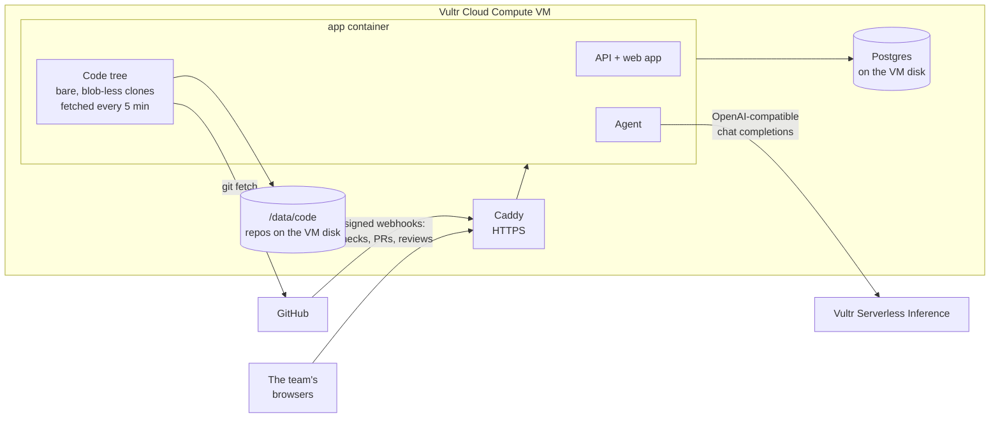

# Studio OS

**A code CRM for software studios.** Every client project is a living tree. Main is the trunk, branches grow off it, and merged work grafts back in. Tap any commit to see what changed and the code exactly as it was then. An agent on Vultr Serverless Inference explains a commit or a whole branch in plain words, and the People page shows what everyone is building right now.

It started as the system [North Tech Africa](https://northtech.africa), a two-person studio, wanted for itself: one place that answers "what is happening in each client's code, and who is on it?" without opening five GitHub tabs.

> **Try the live demo at [studio.dataquant.dev](https://studio.dataquant.dev):** sign in as the manager or the developer from the buttons on the sign-in page. The demo studio, its clients and its three repositories are made up; next to them sit two real projects, BidScope's front end and Studio OS itself, with a real contribution graph on the People page. The demo accounts are shared, so they can look around, ask the agent and plant a few repos but not change settings; start your own space to try everything.

---

## What you see

**Tree** (home)
- The **tree** fills the screen, drawn as line work in the accent colour. Main is the trunk; each branch is a labelled card, and every commit is its author's face with its subject beside it. Merged branches, even ones deleted on GitHub, are rebuilt from their merge commits. *Replay* grows the whole tree commit by commit.
- A **project switcher** across the top. Each project has a **health dot** that comes from the code alone: red when checks are failing, amber when a branch has had no commits for 10 days, a review is waiting, or an active project has gone quiet for 14 days.
- A **side panel** that is always there. With nothing picked, it says in plain words what changed this week and why the project needs a look. Pick a commit or branch and it shows who made it, what changed in plain words, *Code at this point* (the diff and every file in the repo as it was), *Explain branch*, and **Ask the agent**, which takes any question about the code at that commit ("anything risky here?", "where is the deposit taken?").
- **Contributors** at the bottom of the panel. Tap a person and the tree lights up only their work.

**View**: any commit or branch of a website opens the site itself, exactly as it was at that commit, served by the VM straight from git. Play a branch and watch the site grow commit by commit: in the demo, Tidepool's booking site goes from a bare skeleton to hero, dive calendar, course cards and the deposit form.

**Plant a repo**: type a GitHub username to pick from its public repos, or paste any `owner/name`, and its tree grows in seconds. Anyone can start their own space from the sign-in page, so it works the same for a solo developer as for a team.

**Projects**: every project grouped by client, with its health dot, open branches, last commit and the reasons it needs a look. Each one opens its tree, or its page with phases and the task board kept in step with GitHub issues.

**People**: a profile for each person, like a GitHub profile: a contribution graph of the last six months, what they are working on now across every project, the reviews waiting on them, and their recent commits. Every branch and commit links straight to that spot on the tree.

**Settings**: the company name and colour, the team and their GitHub logins (so commits match people), and the GitHub and Vultr connections.

## How it uses Vultr



- **Vultr Cloud Compute is where the code lives.** Each linked repository is kept on the VM's own disk as a bare, blob-less clone (history first, file contents fetched the first time someone opens them). The server fetches every repo every five minutes, so the tree is always current and walking back through old code never waits on GitHub or hits its API rate limits. This is why it needs a machine and not functions: an always-on process, a persistent disk and `git` itself.
- **Vultr Serverless Inference is the agent.** When someone asks it to explain a commit or a branch, the server gathers the facts (authors, the commits, files changed, and the diff trimmed to fit) and asks the model for a short summary and a list of things a reviewer should check, as JSON. Answers are cached per commit. Questions in *Ask the agent* are grounded the same way: the commit, its diff, every file in the repo at that point, and any file the question names, read straight from git. The client is plain OpenAI-compatible chat completions, so `INFERENCE_BASE_URL`, `INFERENCE_API_KEY` and `INFERENCE_MODEL` point it at any compatible endpoint; it defaults to Vultr. Without a key, the agent still answers from the same facts in plain words: who changed what, which areas, whether payment or auth code was touched, and whether tests came with it.
- **The VM serves every commit's website.** `View` asks the server for a signed link that expires in six hours. The files come straight out of git at that commit (the first folder with an `index.html`: the root, `public/`, `site/`, `docs/`, `dist/` and so on), with a sandbox Content-Security-Policy, so a site's scripts run in an opaque origin and can never reach the app, even when the page is opened in its own tab.
- **Postgres on the VM** holds the people, projects and GitHub events (checks, pull requests, review requests) that feed the health dots.

## Architecture

```
apps/api/src/codetree.ts      the repos on disk: graph, commit, files, file at a commit, range
apps/api/src/codeinsights.ts  health per project and work per person, from the code
apps/agent/src/explain.ts     the agent's commit and branch explanations
apps/agent/src/ask.ts         questions about the code at a commit
apps/web/src/pages/CodeTree.tsx   the tree: layout, drawing, commit panel, contributors
apps/api                      Hono API, sessions, GitHub webhook, demo data
packages/core                 records, events, actions, registry
modules/*                     projects and GitHub sync (and older back-office modules, switched off in the UI)
deploy/                       Caddyfile and the VM deploy script
```

**How the tree is grown.** The server returns branches and up to 400 commits with their parents. The browser takes the default branch's first-parent chain as the trunk, walks each open branch back until it meets a commit the tree already owns, and rebuilds merged-and-deleted branches from the second parent of each merge commit. Branches are given lanes left and right of the trunk so overlapping ones never cross, and the whole thing is drawn as SVG: tapering bark, leaves on open work, knots on the trunk, roots in the soil, a date gutter on the left.

**Safety.** Only repositories linked to a project can be read. Commit ids, repo names and file paths are validated before they reach `git` (no `..`, no leading `-`, no refs like `HEAD`), files are capped at 200 kB and diffs at 120 kB, and `git` runs with no prompts and a timeout. A private repo needs a token on the server, which never reaches the browser.

## Run it locally

Needs Node 22 and git.

```bash
npm install
npm run build                # the web app
DATABASE_URL=pglite: SESSION_SECRET=$(openssl rand -hex 32) \
  SEED_DEMO=1 DEMO=1 COOKIE_SECURE=0 npm start
# open http://localhost:3000
```

`SEED_DEMO=1` builds the three demo repositories with real git history (dated relative to today) and links them to the demo projects. Next to them, `DEMO_REPOS` (`owner/name=Title,…`), `DEMO_CLIENT` and `DEMO_OWNER` (`Full Name|github-login`) add real public repos and a real person to the demo, so visitors also see real trees and a real contribution graph. The Docker setup shows North Tech Africa's own repos by default. `DATABASE_URL=pglite:` runs Postgres in-process, so there is nothing else to install.

Tests run against a real Postgres engine in memory and real git repos:

```bash
npm run typecheck && npm test
```

## Deploy to a Vultr VM

**The quick way, no SSH:** in Vultr, add [deploy/vultr-startup.sh](deploy/vultr-startup.sh) under *Orchestration → Scripts* as a Boot script, then deploy a Cloud Compute instance (Ubuntu 24.04) with it. The VM installs Docker, deploys from this repo, and redeploys by itself within three minutes of every push to `main`. Add `VULTR_INFERENCE_API_KEY=...` to `/opt/studio-os/.env` from the Vultr console and run `docker compose up -d` there to turn the model on.

**With GitHub Actions:**

1. Create a **Cloud Compute** instance (Ubuntu 24.04, 2 vCPU / 4 GB is plenty) with your SSH key, and open ports 22, 80 and 443.
2. In the GitHub repo, add the secrets `VM_HOST` (the VM's IP), `VM_SSH_KEY` (the private key) and `VULTR_INFERENCE_API_KEY`. Optionally add the variables `STUDIO_DOMAIN` (for HTTPS) and `VULTR_INFERENCE_MODEL`, and the secrets `STUDIO_GITHUB_TOKEN` (for private repos) and `STUDIO_GITHUB_WEBHOOK_SECRET`.
3. Push to `main`. [The workflow](.github/workflows/deploy.yml) tests, then runs [deploy/remote.sh](deploy/remote.sh) on the VM over SSH: it installs Docker the first time, generates the database password and session secret once, and runs `docker compose up`. Repos are kept in the `code` volume.

Point a DNS A record at the VM and set `STUDIO_DOMAIN`; Caddy gets the certificate. To start your own company alongside the demo:

```bash
docker compose exec app npm run admin -- create-company "Your Studio" you@studio.co.za "Your Name" 'a long password'
```

Then link each project to its repo (`owner/name`) and its tree appears. For checks, pull requests and reviews, give each repo a webhook to `https://<your domain>/api/github/webhook?company=<company id>` with your webhook secret.

## Security notes

- On a public demo (`DEMO=1`) the shared demo accounts are read-only apart from asking the agent and planting up to 8 repos; `DEMO_UNLOCKED=1` turns that off.
- Sessions are signed, HTTP-only, `SameSite=Lax` cookies; changes must be JSON, which blocks cross-site form posts. Sign-in is rate limited.
- GitHub webhooks are checked against `X-Hub-Signature-256`.
- Secrets live only in GitHub secrets and the VM's `.env` (mode 600).

## License

[MIT](LICENSE)
