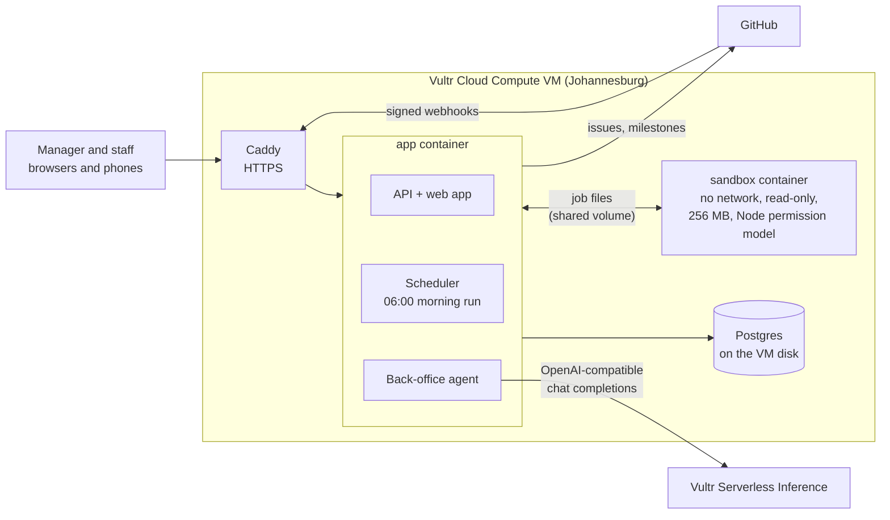

# Studio OS

**The back office for small software studios.** Projects, money, people and GitHub in one system, with two sides: a manager side for running the business and a phone-first employee side for doing the work. A back-office agent does the morning rounds on Vultr Serverless Inference and asks before anything leaves the building.

Built for studios of two to twenty people, where the founder is also the developer, the bookkeeper and the account manager. It started as the system [North Tech Africa](https://northtech.africa) needed for itself.

> **Try the demo:** sign in as the manager or the employee from the buttons on the sign-in page. Everything in the demo studio is made up.

---

## What it does

**The manager side** opens on *Today*:

- a **morning brief** the agent wrote at six: cash, what is overdue, deadlines, who to follow up;
- **Waiting for you**: invoices to send and payment reminders the agent or your rules prepared. Nothing that sends money or messages outside the studio happens without a click here;
- **tiles** for cash in the bank, money owed, this month, runway, project health, SARS and CIPC deadlines, the sales pipeline, team hours, shipping on GitHub and payroll.

Behind it: projects on a **phase and payment plan** (finish *Discovery* and its 40% invoice drafts itself), a task board, invoices and the **bank feed** (FNB, Absa, Nedbank, Capitec and Standard Bank CSVs; Studio OS matches payments to invoices), expense claims, leave, payroll with SARS PAYE and UIF, leads, compliance deadlines, automations and settings.

**The employee side** is built for a phone: *My day*, my tasks, **time suggested from my GitHub commits** to confirm, expense claims, leave, and payslips. Employees never see salaries, rates, project values or anyone else's claims.

**GitHub, both ways:**

| In GitHub | In Studio OS |
|---|---|
| Milestone | Phase. Closing the milestone finishes the phase and drafts its invoice |
| Issue | Task, assigned by GitHub login |
| Pull request mentioning `#12` | Task 12 moves to *In review*; merged with `Closes #12`, it is *Done* |
| Review requested | Shows on the reviewer's *My day* |
| Commits | Suggested time for that person and project, to confirm |
| Failed checks, merges, releases | The *Shipping* tile |

Going the other way, a task created in Studio OS opens an issue, a phase opens a milestone, and finishing either closes it on GitHub.

## Made to be reshaped

Every studio bills, names things and works differently, so Studio OS keeps those differences in data rather than code. All of this is in **Settings**, with no redeploy:

- **Modules** switch on and off: Projects (always on), Money, People, Sales, Compliance, GitHub. Each module declares its record types, events, actions and tiles in one manifest ([modules/money/src/index.ts](modules/money/src/index.ts)).
- **Custom fields** on any record type (a VAT number on clients, a cost centre on projects). Forms, detail pages and validation pick them up.
- **Statuses** can be renamed or extended per record type.
- **Project types** set the phases and how the project value is split across them: 40/30/30, 50/50, retainer or hourly.
- **Screens**: the order of tiles on each side, and which to show.
- **Automations**: *when* an event happens, *if* conditions hold, *then* run an action, with values from the event (`{{payload.invoiceId}}`). Rules that would send money or messages always queue for approval.
- **Brand**: the company's name and colour run through every screen and email.

Because the UI, automations and the agent all call the same named **actions**, a new module's actions appear on record pages, in the rule builder and in the agent's toolbox at once.

## How it uses Vultr



- **Vultr Cloud Compute** runs the whole system with Docker Compose. It needs a machine, not functions: the agent's scheduler is always on, Postgres keeps the studio's financial records on the VM's own disk, and the sandbox is a separate container with **no network interface at all**.
- **Vultr Serverless Inference** is the agent's model. Each morning it reads the facts the system gathered (never the raw database) and returns a brief plus proposed actions as JSON. Proposals are checked against an allow-list, deduplicated and queued for approval. The agent can draft a reminder; it cannot send one.
- **Code the agent writes runs in the sandbox.** When a bank exports a statement format Studio OS has never seen, the agent writes a small parser. That code runs in the sandbox container, in a Node process started with `--permission` (no file access beyond its own job, no child processes, no workers), with a 5 second limit. Its output is validated, the manager sees a preview, and only then is anything imported. The parser is kept for the next statement in that format.

Without an inference key the agent still runs and writes a plain brief from the same facts, so the system never depends on the model being up.

## Architecture

```
packages/core        records, events, actions, approvals, automations, registry
packages/testing     in-memory Postgres (PGlite) studio for tests
modules/*            projects, money, people, sales, compliance, github
apps/api             Hono API, sessions, GitHub webhook, scheduler, seed data
apps/agent           morning run, Vultr inference client, statement parser writer
apps/sandbox         the runner for untrusted code
apps/web             React app: /manage and /me
deploy/              Caddyfile and the VM deploy script
```

The core idea: **everything is a typed record, every change is an event, everything the system can do is an action.**

- A **record** has a type, a status, a parent (task → project → client) and validated data. Visibility is per type (`everyone`, `managers`, or `assigned` through a user field), and sensitive fields are stripped for employees on the server.
- **Events** (`invoice.overdue`, `task.done`, `github.pr_merged`) are stored as the audit trail, then handed to module listeners and to the company's automation rules.
- **Actions** declare their parameters and whether they `needsApproval`. A manager clicking a button runs it; a rule or the agent asking for it queues it.

Money is always whole cents. South African PAYE uses SARS's tables for the 2027 tax year, kept as data in [modules/people/src/payroll.ts](modules/people/src/payroll.ts); payslips stay drafts until a manager issues them.

## Run it locally

Needs Node 22.

```bash
npm install
npm run build                # the web app
DATABASE_URL=pglite: SESSION_SECRET=$(openssl rand -hex 32) \
  SEED_DEMO=1 DEMO=1 COOKIE_SECURE=0 npm start
# open http://localhost:3000
```

`DATABASE_URL=pglite:` runs Postgres in-process, so there is nothing else to install. For development, `npm run dev:api` and `npm run dev:web` (Vite on :5173, proxying the API).

Tests run against a real Postgres engine in memory:

```bash
npm run typecheck && npm test
```

## Deploy to a Vultr VM

1. Create a **Cloud Compute** instance (Ubuntu 24.04, 2 vCPU / 4 GB is plenty) with your SSH key, and open ports 22, 80 and 443.
2. In the GitHub repo, add the secrets `VM_HOST` (the VM's IP), `VM_SSH_KEY` (the private key) and `VULTR_INFERENCE_API_KEY`. Optionally add the variables `STUDIO_DOMAIN` (for HTTPS) and `VULTR_INFERENCE_MODEL`, and the secrets `STUDIO_GITHUB_TOKEN` and `STUDIO_GITHUB_WEBHOOK_SECRET` for GitHub sync.
3. Push to `main`. [The workflow](.github/workflows/deploy.yml) tests, then runs [deploy/remote.sh](deploy/remote.sh) on the VM over SSH: it installs Docker the first time, generates the database password and session secret once, and runs `docker compose up`.

Point a DNS A record at the VM and set `STUDIO_DOMAIN`; Caddy gets the certificate. To start your own company alongside the demo:

```bash
docker compose exec app npm run admin -- create-company "Your Studio" you@studio.co.za "Your Name" 'a long password'
```

For GitHub sync, give each repo a webhook to `https://<your domain>/api/github/webhook?company=<company id>` with your webhook secret, and link the repo on its project.

## Security notes

- Sessions are signed, HTTP-only, `SameSite=Lax` cookies; changes must be JSON, which blocks cross-site form posts. Sign-in is rate limited.
- Employees cannot see managers-only records, cannot read sensitive fields, cannot approve their own claims or leave, and cannot create records for someone else.
- GitHub webhooks are checked against `X-Hub-Signature-256`.
- To watch the sandbox refuse network, file reads, child processes and endless loops on a running VM: `docker compose exec app node_modules/.bin/tsx apps/api/src/sandbox-check.ts`.
- Secrets live only in GitHub secrets and the VM's `.env` (mode 600). The demo sends no email; messages land in the Activity outbox.

## License

[MIT](LICENSE)
